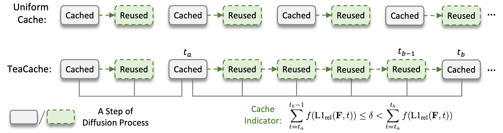
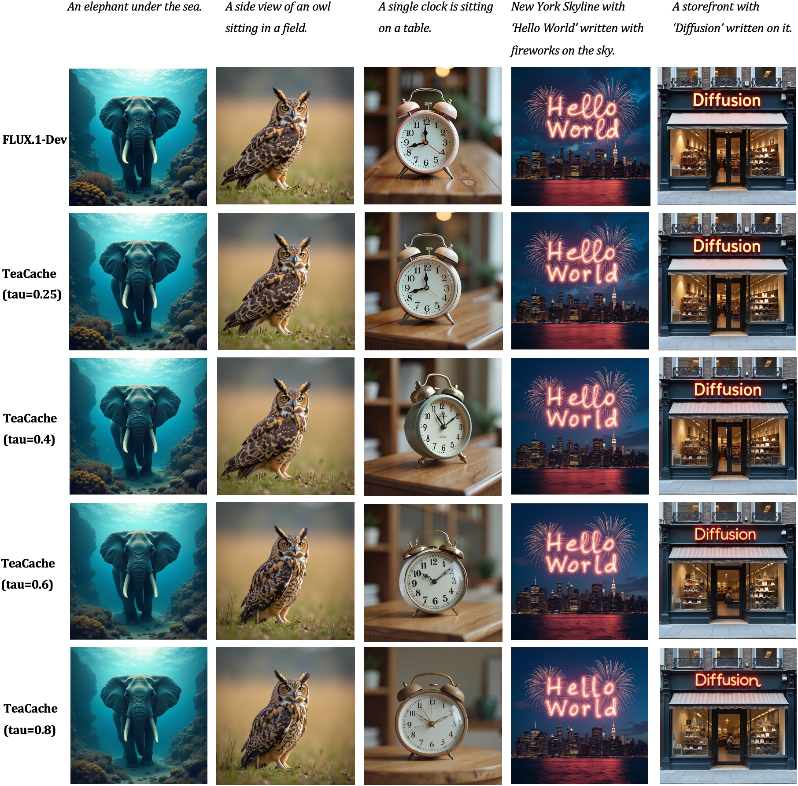

# TeaCache: Timestep Embedding Tells — It's Time to Cache

This is a highly readable and easy-to-use implementation of TeaCache, a training-free diffusion acceleration method with *timestep-aware residual caching*.

## ✨Introduction

> Diffusion Transformers produce high-quality images and videos through repeated denoising steps, making inference computationally expensive. Reusing intermediate features can reduce this cost, but the amount of change between consecutive steps varies throughout generation. TeaCache uses changes in timestep-modulated inputs to estimate changes in transformer outputs. For FLUX.1-dev, this implementation measures the relative L1 distance between consecutive inputs modulated by the first transformer block, maps it through the official calibration polynomial, and accumulates the estimated change. When the accumulated value reaches a threshold, the model recomputes the transformer blocks and refreshes the cached residual. Otherwise, it adds the cached residual to the current image features. The first and last steps always run the full block stack. This repository separates the core caching algorithm, model adapters, and reversible integration utilities, making the implementation easy to inspect and extend. The current adapter supports **FLUX.1-dev** through Diffusers.



## 📋TODO List

- [x] Initialize this project.
- [x] Implement the core TeaCache algorithm.
- [x] Support FLUX.1-dev.
- [x] Support DrawBench generation, scoring, and report export.
- [ ] Publish evaluation results and qualitative comparisons.
- [ ] Support more generative models.

## 📦Installation

In this project, we use [uv](https://github.com/astral-sh/uv) for package management. Python **3.12 or newer** is required. FLUX inference examples require a CUDA GPU with sufficient memory.

1. **Clone this repository and navigate to the TeaCache folder:**

```bash
git clone https://github.com/FANtier-Labs/TeaCache.git
cd TeaCache
```

2. **Install the inference package:**

```bash
uv sync
```

For DrawBench evaluation, install the additional dependencies:

```bash
uv sync --extra eval
```

Activate the environment with `source .venv/bin/activate`, or prefix the Python commands below with `uv run`.

## 🚀Quickstart

Create a `CacheManager` and apply the FLUX adapter within a `with` block:

```python
import torch
from diffusers import FluxPipeline
from teacache import CacheManager, FluxAdapter, TeaCacheConfig

pipe = FluxPipeline.from_pretrained(
    "black-forest-labs/FLUX.1-dev",
    torch_dtype=torch.bfloat16,
).to("cuda")

config = TeaCacheConfig(rel_l1_thresh=0.6)
manager = CacheManager(config)

with FluxAdapter().patch(pipe, manager):
    image = pipe(
        "A cat holding a sign that says hello world",
        num_inference_steps=50,
        guidance_scale=3.5,
        generator=torch.Generator("cpu").manual_seed(42),
    ).images[0]

image.save("flux_teacache.png")
```

- `rel_l1_thresh`: threshold for the accumulated calibrated relative L1 distance. A value of `0` disables skipping; larger values allow more reuse and may reduce image quality.

Each context handles one generation request. Exiting the `with` block restores the original `forward` methods and clears the cached tensors, including when generation raises an exception. Use a fresh patch scope for each request and avoid concurrent access to the same pipeline or manager.

## 🔌Adapters

Currently, we support one adapter: **FLUX**, targeting standard FLUX.1-dev text-to-image generation. The inference demo is available in `playground/`:

```bash
python playground/flux.py \
    --prompt "A cat holding a sign that says hello world" \
    --enable-teacache \
    --model-path "black-forest-labs/FLUX.1-dev" \
    --steps 50 \
    --guidance 3.5 \
    --rel-l1-thresh 0.6 \
    --seed 42 \
    --height 1024 \
    --width 1024 \
    --output-path outputs/flux_teacache.png
```

Omit `--enable-teacache` to run the baseline.

## 📊Evaluation

The evaluation framework compares **FLUX.1-dev** with and without TeaCache on [DrawBench](eval/drawbench/data.jsonl), containing 200 prompts. Defaults are one image per prompt, matching seeds, 50 inference steps, 1024 × 1024 resolution, and guidance scale 3.5. Each worker performs one untimed warmup generation before measuring samples.

Generate the baseline, then generate and score TeaCache candidates:

```bash
bash scripts/flux/run_base.sh
THRESHOLDS="0.25 0.4 0.6 0.8" bash scripts/flux/run_teacache.sh
```

Both scripts accept generation options such as `--limit`, `--steps`, and `--seed`; use identical options for the baseline and candidates. The framework supports multiple GPU workers, resumable generation, paired scoring, and JSON/CSV export. See the [evaluation guide](eval/drawbench/README.md) for configuration and output details.

Latency uses the same shared CUDA Event timing function as `playground/flux.py`, covering the pipeline call while excluding model loading, patch setup/teardown, disk saving, and scoring. Overall speedup is the sum of paired baseline inference times divided by the sum of TeaCache inference times. This measures per-sample acceleration rather than multi-GPU job throughput.

> **Results placeholder:** Populate the table after completing evaluation runs. Dashes indicate results that have not been reported.

| Method | Latency (s) ↓ | Speedup ↑ | CLIP similarity ↑ | PSNR (dB) ↑ | LPIPS ↓ |
| --- | ---: | ---: | ---: | ---: | ---: |
| FLUX.1-dev | — | 1.00× | — | — | — |
| TeaCache (threshold = 0.25) | — | — | — | — | — |
| TeaCache (threshold = 0.4) | — | — | — | — | — |
| TeaCache (threshold = 0.6) | — | — | — | — | — |
| TeaCache (threshold = 0.8) | — | — | — | — | — |

CLIP similarity measures prompt alignment using the raw cosine similarity from OpenAI CLIP ViT-B/32. PSNR and LPIPS compare candidate images against paired baseline images. Latency is averaged per image. Reports include overall, category, and per-sample results under `outputs/drawbench/flux/threshold_*/report/`.

## 🎨Visualizations

> **Visualization placeholder:** Add qualitative comparisons between baseline FLUX.1-dev and TeaCache at different thresholds, using identical prompts and seeds.

<!-- Add the image once available:

-->

## 👏Acknowledgement

This project builds upon the official implementation of [TeaCache](https://github.com/ali-vilab/TeaCache) and integrates with [Diffusers](https://github.com/huggingface/diffusers). Thanks for their excellent work!
